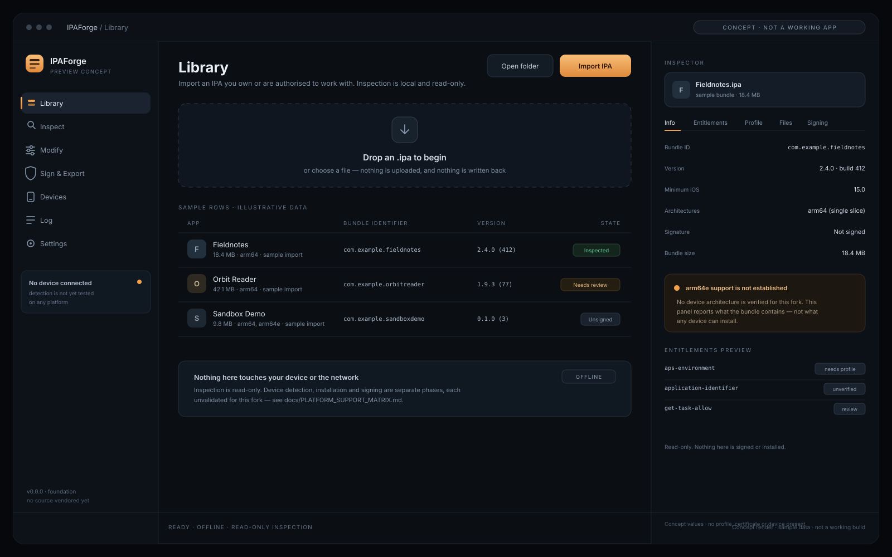
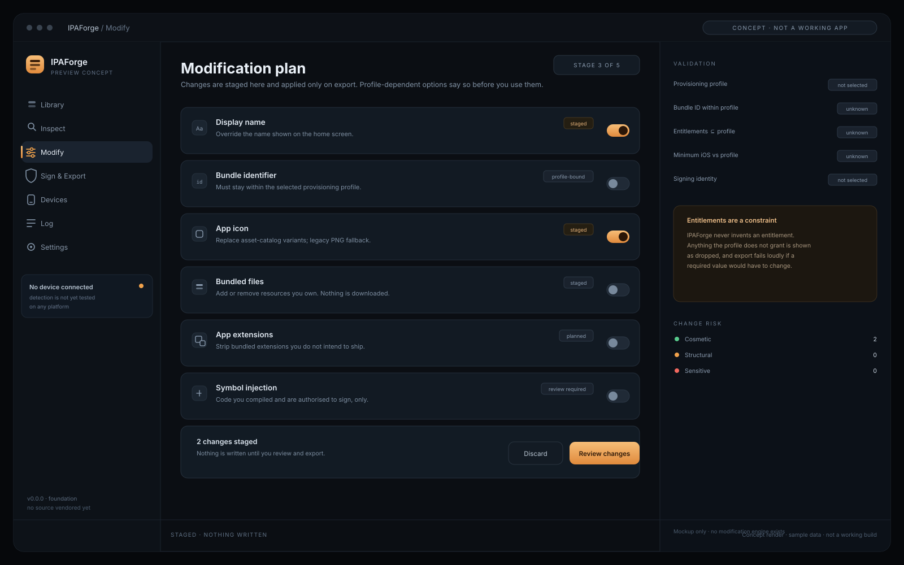
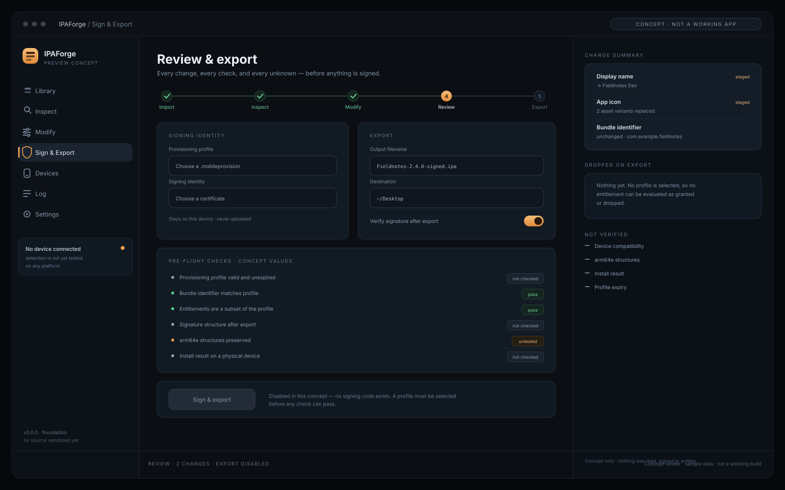
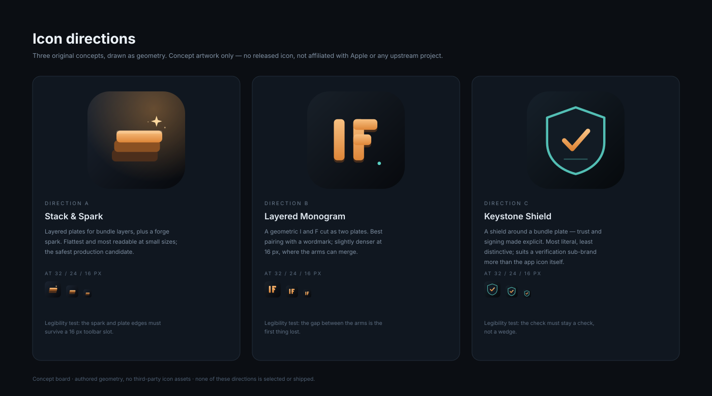

# IPAForge

**A desktop workbench for inspecting, modifying, and re-signing iOS app bundles you own or are authorized to work with.**

> **Status: pre-development foundation.**
> This repository currently contains project documentation, brand concept assets, and UI concept mockups only.
> **There is no application source code, build system, or test suite here yet.** The iLoader and Impactor sources
> will be vendored in a later, separately reviewed step.
>
> Every statement in this repository about upstream behaviour, tooling, platform support, or device compatibility is
> explicitly marked **planned**, **investigating**, **not yet tested**, or **TBD**. Nothing about upstream has been
> verified here, because no upstream code is present.



*Concept only — an illustration of the intended experience, not a screenshot of a working application. All names,
versions, bundle identifiers, and statuses in the mockups are invented sample data.*

---

## Repository status at a glance

| Area | State |
| --- | --- |
| Application source | **Not present** — iLoader / Impactor vendoring pending |
| Build system | **TBD** — depends on upstream toolchain |
| Automated tests | **None** — no test has been written or run |
| Supported platforms | **None verified** — see [platform support matrix](docs/PLATFORM_SUPPORT_MATRIX.md) |
| Release artifacts | **None** — no binaries, installers, or releases exist |
| License for this repository | **TBD** — pending upstream license review, see [attribution notes](docs/UPSTREAM_ATTRIBUTION.md) |

## What IPAForge is

IPAForge is a working name for a desktop fork intended to build on two upstream projects: **iLoader** and
**Impactor**. The product thesis is a single, legible workbench where a developer or power user can:

1. **See** exactly what an `.ipa` contains before touching it.
2. **Change** a small, explicit, auditable set of things.
3. **Sign** the result with a provisioning profile and identity they control.
4. **Review** every difference and every check that passed, failed, or was unknown before anything reaches a device.

The emphasis is on evidence over convenience: if the tool cannot verify something, it says so rather than guessing.

## What IPAForge is not

- Not an app store, a distribution service, or a way to install apps you do not own or have permission to use.
- Not a decryption, DRM-removal, or "cracked IPA" tool. Encrypted App Store binaries are out of scope.
- Not a way to obtain entitlements beyond what a provisioning profile already grants.
- Not a guaranteed-compatibility sideloader. Device support will only ever be claimed after it is reproduced and recorded.
- Not a store of anyone's credentials. Profiles, certificates, and passwords stay local and are never committed.

## Feature vision

All items below are **proposed** and **not implemented**. Each group lists intent, not capability.

### 1. Import and inspect — *planned*

- Open an `.ipa` from disk or drag it in; no network access required to read it.
- Summarise bundle metadata: bundle identifier, display name, short version and build, minimum and SDK version.
- List the architectures present in the main binary and in embedded frameworks.
- Inventory embedded frameworks, dylibs, app extensions, and asset catalogs.
- Summarise the embedded provisioning profile: team, expiry, device-count, and which entitlements it grants.
- Show entitlements as a diff against the profile rather than as a flat list.
- Report signature state honestly: signed, unsigned, ad-hoc, or unrecognised.
- Surface warnings the tool cannot resolve, with the reason the check was inconclusive.

### 2. Modify — *planned, staged like a reviewable patch*

- Rename the display name; change version and build strings.
- Replace the app icon across asset-catalog variants, with a legacy PNG fallback for older bundles.
- Add or remove bundled files and resources that the user owns.
- Remove bundled app extensions or plugins that are not being shipped.
- Adjust localisation strings for an existing language.
- Inject code only when the user supplies a binary they compiled and are authorised to sign.
- Keep every change as an explicit, reversible entry in a modification plan; nothing is written until review.

### 3. Sign, verify, export — *planned*

- Select a provisioning profile and signing identity from the local machine.
- Validate the plan against the profile **before** signing: bundle-ID match, entitlement subset, expiry, platform.
- Reconcile entitlements by retaining only what the profile grants, and show every dropped item.
- Export a signed `.ipa` with an explicit, deterministic output path.
- Re-read the exported bundle and re-verify what was written, including signature structure.
- Produce a short review report: what changed, what was verified, what remained unknown.

### 4. Device workflow — *investigating, wholly dependent on upstream*

- Detect a connected device, pair and trust it, and show a capability summary before install.
- Install, uninstall, and capture logs — **only if** the vendored upstream code demonstrates this on the target host.
- No promise of a device list, iOS version range, or connection method until validated per target.

### 5. Developer ergonomics — *investigating*

- Offline by default; no telemetry and no call-home.
- Optional command-line parity for scripted inspection and signing — *feasibility depends on upstream architecture*.
- Reproducible build instructions once the toolchain is known.
- Research notes and validation results checked into the repository so support claims stay auditable.

## Experience concepts

These are design targets, not screenshots of a product. All three are original concept renders; the UI does not exist.

| Concept | What it explores |
| --- | --- |
|  | **Import & inspect.** A quiet library, a drag-in target, and an inspector that explains every field and flags what it cannot verify. |
|  | **Modification plan.** Changes are staged as explicit toggles with the profile constraint stated next to the option that depends on it. |
|  | **Review, sign, export.** Pre-flight checks distinguish pass, pending, and "not checked" instead of collapsing them into a green tick. |

### Icon directions

Three original icon directions, drawn as geometry. **None is selected, and none is shipped.**



*Concept artwork only — not derived from, or affiliated with, Apple or any upstream project.*

| Direction | Idea | Small-size risk |
| --- | --- | --- |
| **A — Stack & Spark** ([SVG](assets/brand/icon-concepts/01-stack-and-spark.svg)) | Layered plates for bundle layers, plus a forge spark. Flattest and most readable; the safest production candidate. | The spark and plate edges must survive a 16 px toolbar slot. |
| **B — Layered Monogram** ([SVG](assets/brand/icon-concepts/02-layered-monogram.svg)) | A geometric I and F cut as two plates. Best pairing with a wordmark. | Denser at 16 px, where the arms can merge. |
| **C — Keystone Shield** ([SVG](assets/brand/icon-concepts/03-keystone-shield.svg)) | A shield around a bundle plate — trust and signing made explicit. Most literal, least distinctive. | The check must stay a check, not a wedge. |

Brand explorations live in [`assets/brand/`](assets/brand/) and are summarised in the
[product and design brief](docs/PRODUCT_DESIGN_BRIEF.md).

## Roadmap

Phases are sequential. A phase is only "done" when its exit criteria are met and recorded in this repository.

| Phase | Scope | Status | Exit criteria |
| --- | --- | --- | --- |
| **P0 — Foundation** | Docs, brand concepts, UI concepts, support matrix, provenance rules | **In progress** (this commit) | Documentation reviewed; upstream source and licenses recorded |
| **P1 — Vendor & audit** | Add upstream iLoader / Impactor trees unmodified; build them as-is; inventory components and licenses | Not started | Clean build of unmodified upstream on one host; license and provenance report complete |
| **P2 — Read-only inspection** | Import, metadata, architectures, profile summary, entitlements diff | Not started | Inspection works on sample IPAs on one host; no false support claims |
| **P3 — Modification engine** | Staged change plan, icon/name/version edits, resource changes | Not started | Plan round-trips correctly; every change is reviewable and reversible |
| **P4 — Signing & export** | Profile validation, entitlement reconciliation, signed output, re-verification | Not started | Exported bundle verifies locally; entitlement drops are reported |
| **P5 — Device workflow** | Detection, pairing, install, logs | Not started, depends on P1 findings | Reproduced on named host + device pairs, logged and redacted |
| **P6 — Packaging** | Per-platform builds, installers, signing/notarisation decisions | Not started, blocked on P1/P4 | Installable on at least one fully verified host |

No dates are published. Dates would imply a certainty about upstream work that does not exist yet.

## Installation and build

**TBD — and not yet run.** There is nothing to install or build in this repository today. The commands below are
placeholders that describe the shape of the eventual instructions. They are not tested, and they will be rewritten
from the vendored upstream build files.

```bash
# PLACEHOLDER — DO NOT RUN. No build system exists in this repository yet.
git clone <this-repository-url> ipaforge
cd ipaforge

# Step 1 (TBD): vendor upstream sources into the agreed directory layout.
#   Exact layout, submodules vs. vendor copies, and pinned commits: TBD after license review.

# Step 2 (TBD): install host prerequisites. Unknown, because the toolchain is unknown.
#   Candidates depend on upstream language and UI framework: TBD.

# Step 3 (TBD): build.
#   cmake --build … | xcodebuild … | cargo build … | <upstream build command>
#   NOT YET DETERMINED.

# Step 4 (TBD): run.
#   ./ipaforge   # path, binary name, and CLI flags all TBD
```

Release artefacts, installers, notarisation, and packaging are **not planned in detail until P1 and P4 are complete**.

## Development setup

**TBD.** The following placeholders record what must be decided before anyone can contribute code:

- **Toolchain:** unknown; determined by upstream (compiler, SDK, UI runtime). *TBD.*
- **Minimum host versions:** unknown; must be validated per target, not asserted. *See the matrix.*
- **Repository layout:** proposed only — `vendor/<upstream>/`, `src/`, `docs/`, `assets/`, `tools/`. *TBD after P1.*
- **Dependency policy:** no new runtime dependency without a recorded license and purpose. *Proposed.*
- **Formatting and linting:** not selected. *TBD.*
- **Tests:** no harness exists. Once upstream builds, the first tests must cover bundle parsing and entitlement
  subset validation, both of which are pure functions and can run without a device.

### Local secrets policy

- Never commit `.mobileprovision`, `.p12`, `.cer`, `.pem`, passwords, team tokens, or device UDIDs.
- Store local development credentials outside the repository (keychain, or an ignored local directory).
- Use clearly fake values in examples: `com.example.app`, `00000000-0000-0000-0000-000000000000`, `<TEAM_ID>`.
- Screenshots and logs used in issues must be redacted: no serial numbers, UDIDs, email addresses, or paths that
  reveal a real identity.

## Platform support

**No platform, architecture, or connection method is supported today.** The
[platform support matrix](docs/PLATFORM_SUPPORT_MATRIX.md) separates:

- **Host** operating systems and CPU architectures (Windows x86 / x86_64, Intel macOS, Apple Silicon macOS,
  Linux x86_64 / ARM) — all *proposed targets to investigate*.
- **iOS device** architectures (arm64, arm64e, legacy 32-bit) — support is only claimable where upstream code, SDKs,
  signing paths, and tested hardware establish it.
- **Connection** paths (USB transports, pairing modes, network pairing) — each *not yet tested*.

Each row carries the validation work required before its status can change.

## Authorized use and safety scope

IPAForge is intended for **IPAs you own or are explicitly authorised to modify** — your own apps, your own builds,
apps you have written permission to work on, and research on hardware you control.

**Explicitly out of scope, by design:**

- Removing DRM, decrypting FairPlay-protected App Store binaries, or extracting content from apps you do not own.
- Injecting or escalating entitlements beyond those the selected provisioning profile already grants.
- Bypassing device pairing, trust, or Developer Mode verification.
- Circumventing App Store rules, licence terms, or export controls.
- Redistributing Apple SDKs, signing certificates, provisioning profiles, or any third-party credentials.
- Shipping tooling that turns the project into a piracy or "free paid app" pipeline.

**Entitlement stance.** Entitlements are treated as a *constraint*, not a dial. The tool may read entitlements from
the selected provisioning profile, may retain a subset of them, and must refuse or visibly drop anything the profile
does not grant. It must never invent an entitlement, request one on the user's behalf, or silently widen one.

**Honesty stance.** When a check cannot be performed — no device attached, no profile selected, an architecture
without a tested signing path — the UI and the CLI must report *unknown*, never *success*.

## Licensing, attribution, and provenance

**All upstream licensing facts are unverified.** The iLoader and Impactor sources are not present here, so no license
text, copyright line, or obligation has been checked. Treat every upstream item as *unknown* until
[`docs/UPSTREAM_ATTRIBUTION.md`](docs/UPSTREAM_ATTRIBUTION.md) is filled in and reviewed.

Required before any source is added:

1. Record the canonical repository URL, the exact commit SHA, and the fetch date for each upstream project.
2. Copy each upstream `LICENSE` / `COPYING` file verbatim into the vendored tree and record its SPDX identifier.
3. Determine whether the license is permissive (MIT/BSD/Apache-2.0), weak/strong copyleft (LGPL/GPL/AGPL), or
   proprietary. **The distribution plan depends on this and is currently blocked.**
4. Preserve copyright notices and any `NOTICE` file; add a `THIRD_PARTY_NOTICES.md` summarising components.
5. State modifications with dates, as most licenses require when a fork is distributed.
6. Check upstream naming and trademark policy before using "iLoader" or "Impactor" in the product UI.
7. Confirm the license of this repository's own new code — it cannot be chosen until step 3 is answered.
8. Do not publish binaries, installers, or releases until 1–7 are complete and reviewed.

"IPAForge" is a working title. It is not derived from, and must not be presented as endorsed by, either upstream
project or Apple. See [`docs/UPSTREAM_ATTRIBUTION.md`](docs/UPSTREAM_ATTRIBUTION.md) for the full checklist.

## Contributing

What is useful **right now**, before any source exists:

- Review the [product/design brief](docs/PRODUCT_DESIGN_BRIEF.md) and the [support matrix](docs/PLATFORM_SUPPORT_MATRIX.md)
  for claims that are too strong or too vague.
- File target-validation reports using real hardware, with redacted logs and exact versions.
- Improve the concept mockups or icon geometry.

What is **blocked**: code pull requests, build-system changes, and dependency additions — there is no code tree to
patch, and the toolchain is unknown.

House rules: no capability claims without a reproducible record; no secrets, real credentials, or device identifiers
in issues or commits; no changes to git remotes or history; no publishing without explicit maintainer approval.

## Repository contents today

```text
ipaforge/
├── README.md                        this file
├── docs/
│   ├── PRODUCT_DESIGN_BRIEF.md      product thesis, UX principles, design language
│   ├── PLATFORM_SUPPORT_MATRIX.md   host / device / connection targets and validation work
│   └── UPSTREAM_ATTRIBUTION.md      license and provenance checklist (all unverified)
└── assets/
    ├── README.md                    what the assets are, and what they are not
    ├── brand/
    │   ├── ipaforge-lockup.svg      mark + wordmark lockup
    │   ├── icon-concept-sheet.svg   three icon directions, with rationale and small-size tests
    │   └── icon-concepts/           individual icon SVGs (512 × 512)
    └── mockups/                     three UI concept screens (SVG source only)
```

No application directories (`src/`, `vendor/`, `tools/`) exist yet, and none are implied by this tree.

## Open questions

- Which upstream commit, and is its source complete and buildable as published? *TBD at P1.*
- Which desktop UI toolkit does the fork keep, and does the upstream architecture permit a modern shell? *TBD at P1.*
- Can signing be performed on hosts without Apple's toolchain, and for which flows? *Investigating; likely the single
  biggest constraint on the Linux targets.*
- Which iOS versions and device architectures are genuinely reachable? *Not yet tested; no claim is made.*
- Final product name, license, and distribution model. *TBD after license review.*
